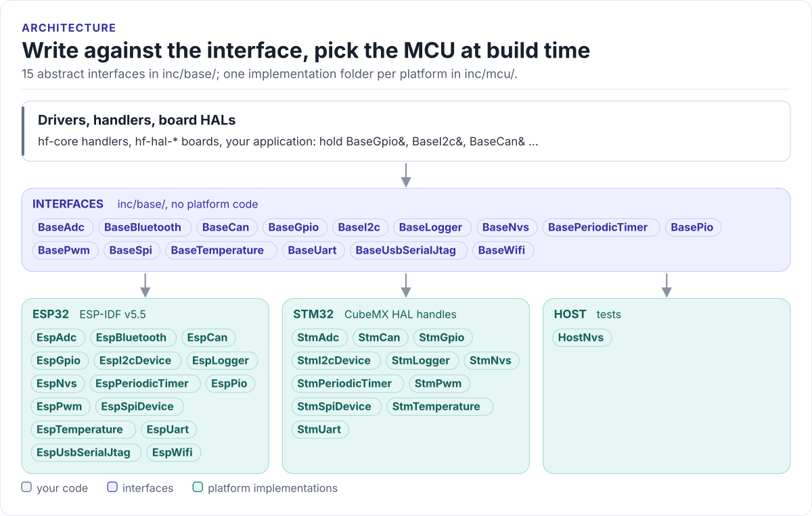

# Internal Interface Wrap

Abstract C++ interfaces for the peripherals of a motor-control board (GPIO, ADC, PWM, I2C, SPI, UART, CAN, NVS,
timers, logging, Wi-Fi, Bluetooth) and their implementations for ESP32, STM32 and the host.

[](https://github.com/hardfoc/hf-internal-interface-wrap/actions/workflows/host-tests.yml)
[](https://github.com/hardfoc/hf-internal-interface-wrap/actions/workflows/esp32-examples-build-ci.yml)
[](https://hardfoc.github.io/hf-internal-interface-wrap/)
[](LICENSE)

**Documentation: <https://hardfoc.github.io/hf-internal-interface-wrap/>**

<!-- figure: interface-layers -->
<picture>
  <source media="(prefers-color-scheme: dark)" srcset="docs/diagrams/interface-layers.dark.svg">
  
</picture>
<!-- /figure -->

## In 30 seconds

Write code against the interfaces; the board passes in `EspGpio` and `EspI2cDevice` on an ESP32, the `Stm*`
classes on an STM32, or a test double on the host:

<!-- generated: quickstart-code -->
```cpp
#include "BaseGpio.h"
#include "BaseI2c.h"

// Reads a sensor's WHO_AM_I register and lights an LED when it matches.
// Nothing here knows which MCU it runs on: pass in EspGpio / EspI2cDevice,
// StmGpio / StmI2cDevice, or a test double.
bool check_sensor(BaseI2c& sensor, BaseGpio& led) {
  constexpr hf_u8_t kWhoAmIReg = 0x0F;
  constexpr hf_u8_t kExpectedId = 0x6C;

  if (!sensor.EnsureInitialized() || !led.EnsureInitialized()) {
    return false; // configures the device and the pin; a no-op the second time
  }
  hf_u8_t id = 0;
  if (!sensor.ReadRegister(kWhoAmIReg, id)) { // write the register address, read one byte
    return false;                             // no ACK: wiring, address or pull-ups
  }
  const bool ok = (id == kExpectedId);
  const hf_gpio_err_t err = ok ? led.SetActive() : led.SetInactive(); // polarity-aware
  return ok && err == hf_gpio_err_t::GPIO_SUCCESS;
}
```
<!-- /generated -->

## What it does

- Fifteen `Base*` interfaces with the same shape: lazy initialisation, an error enum with a `constexpr`
  to-string, statistics and diagnostics, `noexcept` throughout.
- ESP32 implementations of all of them on ESP-IDF v5.5 (`EspGpio`, `EspAdc`, `EspCan`, `EspSpiDevice`,
  `EspI2cDevice`, ...).
- `BaseCan` v2: 64-byte frames for classic CAN and CAN FD, `TrySendMessage()` that never blocks, TEC / REC and
  bus-off through `GetBusStatus()`; `EspCan` receives into a lock-free ring.
- STM32 wrappers over CubeMX HAL handles for eleven interfaces (early: not built in CI).
- A small porting surface: a new MCU implements the pure virtual methods; polarity, validation and statistics
  stay in the base classes.

## Install

```bash
git submodule add https://github.com/hardfoc/hf-internal-interface-wrap.git components/hf-internal-interface-wrap
```

```cmake
# ESP-IDF project CMakeLists.txt
set(EXTRA_COMPONENT_DIRS components/hf-internal-interface-wrap)
```

Code that uses only the interfaces needs just the include paths `inc`, `inc/base` and `inc/utils`. Details:
[Integration](https://hardfoc.github.io/hf-internal-interface-wrap/latest/integration/).

## Documentation

| | |
| --- | --- |
| [Quickstart](https://hardfoc.github.io/hf-internal-interface-wrap/latest/quickstart/) | An ESP32 pin and I2C device passed to portable code |
| [Architecture](https://hardfoc.github.io/hf-internal-interface-wrap/latest/architecture/) | The interface model, lifecycle, errors, threads, MCU selection |
| [API guide](https://hardfoc.github.io/hf-internal-interface-wrap/latest/api-guide/) | Every interface by task, with code that compiles |
| [CAN](https://hardfoc.github.io/hf-internal-interface-wrap/latest/can/) | `BaseCan` v2, the RX ring, bus status, migrating from v1 |
| [Porting](https://hardfoc.github.io/hf-internal-interface-wrap/latest/porting/) | What a new MCU implements, and how to check it |
| [API reference](https://hardfoc.github.io/hf-internal-interface-wrap/latest/api-reference/) | Doxygen for every class |

## Tests

```bash
cmake -S tests/host -B build/host -G Ninja && cmake --build build/host && ctest --test-dir build/host
```

## License

GPL-3.0. See [LICENSE](LICENSE).
