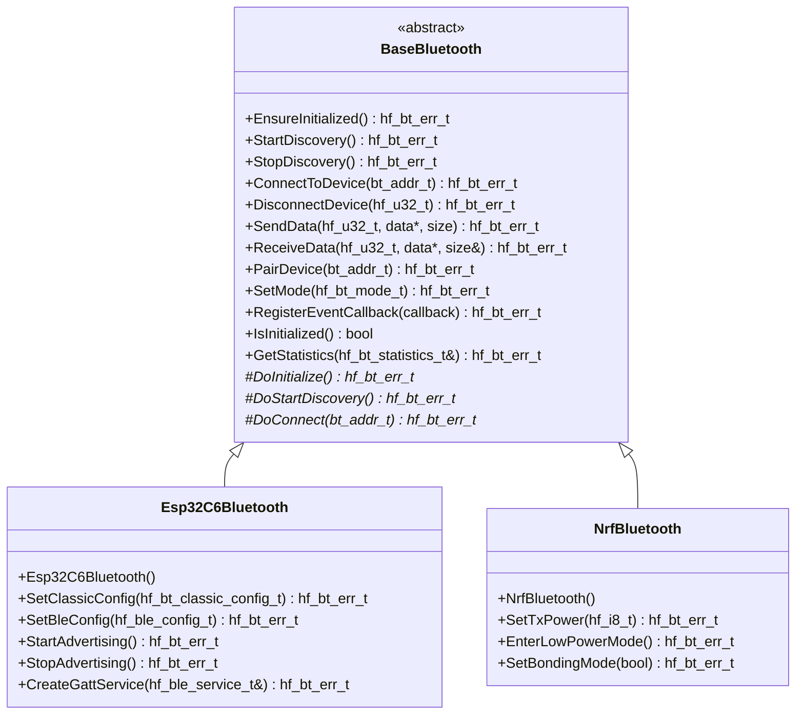

# BaseBluetooth API Reference

## Unified Bluetooth abstraction for Classic and BLE wireless communication
## **Table of Contents**

- [🎯 **Overview**](#overview)
- [🏗️ **Class Hierarchy**](#class-hierarchy)
- [📋 **Error Codes**](#error-codes)
- [🔧 **Core API**](#core-api)
- [📊 **Data Structures**](#data-structures)
- [📲 **Bluetooth Modes**](#bluetooth-modes)
- [📊 **Usage Examples**](#usage-examples)
- [🧪 **Best Practices**](#best-practices)

---

## **Overview**

The `BaseBluetooth` class provides a comprehensive Bluetooth abstraction
that serves as the unified interface for all Bluetooth operations in the
HardFOC system. It supports both Bluetooth Classic and Bluetooth Low Energy
(BLE), device discovery, pairing, connection management, and data transfer
across different hardware implementations.

### **Key Features**

- 📲 **Dual Mode Support** - Both Bluetooth Classic and BLE in a single interface
- 🔍 **Device Discovery** - Scan for and discover nearby Bluetooth devices
- 🤝 **Pairing & Bonding** - Secure device pairing and credential management
- 📡 **Connection Management** - Robust connection handling with reconnection
- 📊 **Service Discovery** - BLE GATT service and characteristic discovery
- 🔐 **Security Support** - Encryption, authentication, and authorization
- 🛡️ **Robust Error Handling** - Comprehensive validation and error reporting
- 🏎️ **Performance Optimized** - Minimal overhead for real-time applications
- 🔌 **Platform Agnostic** - Works across different MCU platforms

### **Supported Hardware**

| Implementation | Classic BT | BLE | Max Connections | Range | Power |

|----------------|------------|-----|-----------------|-------|-------|

| `Esp32C6 Bluetooth` | ✅ | ✅ | 7 connections | 10-100m | Configurable |

| `NrfBluetooth` | ✅ | ✅ | 20 connections | 10-240m | Ultra-low power |

| `Ti2640Bluetooth` | ❌ | ✅ | 3 connections | 10-50m | Low power |

---

## **Class Hierarchy**



---

## **Error Codes**

### **Bluetooth Error Enumeration**

```cpp
enum class hf_bt_err_t : hf_u32_t {
    // Success codes
    BT_SUCCESS = 0,
    
    // General errors
    BT_ERR_FAILURE = 1,
    BT_ERR_NOT_INITIALIZED = 2,
    BT_ERR_ALREADY_INITIALIZED = 3,
    BT_ERR_INVALID_PARAMETER = 4,
    BT_ERR_NULL_POINTER = 5,
    BT_ERR_OUT_OF_MEMORY = 6,
    
    // Connection errors
    BT_ERR_CONNECTION_FAILED = 7,
    BT_ERR_CONNECTION_TIMEOUT = 8,
    BT_ERR_CONNECTION_LOST = 9,
    BT_ERR_DEVICE_NOT_FOUND = 10,
    BT_ERR_DEVICE_UNREACHABLE = 11,
    BT_ERR_MAX_CONNECTIONS_REACHED = 12,
    
    // Pairing errors
    BT_ERR_PAIRING_FAILED = 13,
    BT_ERR_PAIRING_REJECTED = 14,
    BT_ERR_AUTHENTICATION_FAILED = 15,
    BT_ERR_AUTHORIZATION_FAILED = 16,
    BT_ERR_ENCRYPTION_FAILED = 17,
    
    // Discovery errors
    BT_ERR_DISCOVERY_FAILED = 18,
    BT_ERR_DISCOVERY_TIMEOUT = 19,
    BT_ERR_SERVICE_NOT_FOUND = 20,
    BT_ERR_CHARACTERISTIC_NOT_FOUND = 21,
    
    // Data transfer errors
    BT_ERR_SEND_FAILED = 22,
    BT_ERR_RECEIVE_FAILED = 23,
    BT_ERR_BUFFER_OVERFLOW = 24,
    BT_ERR_INVALID_DATA_SIZE = 25,
    
    // BLE specific errors
    BLE_ERR_ADVERTISING_FAILED = 26,
    BLE_ERR_GATT_ERROR = 27,
    BLE_ERR_INVALID_ATT_SIZE = 28,
    BLE_ERR_INVALID_HANDLE = 29,
    
    // Classic specific errors
    BT_CLASSIC_ERR_SPP_FAILED = 30,
    BT_CLASSIC_ERR_PROFILE_ERROR = 31,
    BT_CLASSIC_ERR_SDP_FAILED = 32,
    
    // System errors
    BT_ERR_SYSTEM_ERROR = 33,
    BT_ERR_PERMISSION_DENIED = 34,
    BT_ERR_OPERATION_ABORTED = 35
};
```

### **Error Code Categories**

| Category | Range | Description |

|----------|-------|-------------|

| **Success** | 0 | Successful operation |

| **General** | 1-6 | Basic initialization and parameter errors |

| **Connection** | 7-12 | Device connection and management errors |

| **Pairing** | 13-17 | Security and pairing errors |

| **Discovery** | 18-21 | Device and service discovery errors |

| **Data Transfer** | 22-25 | Data transmission errors |

| **BLE Specific** | 26-29 | BLE protocol specific errors |

| **Classic Specific** | 30-32 | Classic Bluetooth errors |

| **System** | 33-35 | System-level errors |

---

## **Core API**

### **Essential Methods**

#### **Initialization & Configuration**
```cpp
/**
 * @brief Ensure the Bluetooth controller is initialized
 * @return hf_bt_err_t Error code
 */
virtual hf_bt_err_t EnsureInitialized() = 0;

/**
 * @brief Set Bluetooth operating mode
 * @param mode Bluetooth mode (Classic, BLE, or Dual)
 * @return hf_bt_err_t Error code
 */
virtual hf_bt_err_t SetMode(hf_bt_mode_t mode) = 0;

/**
 * @brief Check if Bluetooth is initialized
 * @return bool True if initialized
 */
virtual bool IsInitialized() const = 0;
```

#### **Device Discovery**
```cpp
/**
 * @brief Start device discovery/scanning
 * @param discovery_time_s Discovery duration in seconds
 * @return hf_bt_err_t Error code
 */
virtual hf_bt_err_t StartDiscovery(hf_u32_t discovery_time_s = 10) = 0;

/**
 * @brief Stop device discovery/scanning
 * @return hf_bt_err_t Error code
 */
virtual hf_bt_err_t StopDiscovery() = 0;

/**
 * @brief Get discovered devices list
 * @param devices Output array of discovered devices
 * @param max_devices Maximum devices to return
 * @param actual_count Actual number of devices found
 * @return hf_bt_err_t Error code
 */
virtual hf_bt_err_t GetDiscoveredDevices(hf_bt_device_t* devices,
                                       hf_u32_t max_devices,
                                       hf_u32_t& actual_count) = 0;
```

#### **Connection Management**
```cpp
/**
 * @brief Connect to a Bluetooth device
 * @param device_addr Target device address
 * @param connection_id Output connection ID
 * @return hf_bt_err_t Error code
 */
virtual hf_bt_err_t ConnectToDevice(const bt_addr_t& device_addr,
                                  hf_u32_t& connection_id) = 0;

/**
 * @brief Disconnect from a device
 * @param connection_id Connection ID to disconnect
 * @return hf_bt_err_t Error code
 */
virtual hf_bt_err_t DisconnectDevice(hf_u32_t connection_id) = 0;

/**
 * @brief Check if device is connected
 * @param connection_id Connection ID to check
 * @param is_connected Output connection status
 * @return hf_bt_err_t Error code
 */
virtual hf_bt_err_t IsDeviceConnected(hf_u32_t connection_id,
                                    bool& is_connected) = 0;
```

#### **Data Transfer**
```cpp
/**
 * @brief Send data to connected device
 * @param connection_id Target connection ID
 * @param data Data buffer to send
 * @param data_size Size of data to send
 * @return hf_bt_err_t Error code
 */
virtual hf_bt_err_t SendData(hf_u32_t connection_id,
                           const hf_u8_t* data,
                           hf_u32_t data_size) = 0;

/**
 * @brief Receive data from connected device
 * @param connection_id Source connection ID
 * @param data Buffer to store received data
 * @param buffer_size Size of receive buffer
 * @param received_size Actual bytes received
 * @return hf_bt_err_t Error code
 */
virtual hf_bt_err_t ReceiveData(hf_u32_t connection_id,
                              hf_u8_t* data,
                              hf_u32_t buffer_size,
                              hf_u32_t& received_size) = 0;
```

---

## **Data Structures**

### **Bluetooth Mode Types**

```cpp
enum class hf_bt_mode_t : hf_u8_t {
    BT_MODE_DISABLED = 0,           ///< Bluetooth disabled
    BT_MODE_CLASSIC = 1,            ///< Classic Bluetooth only
    BT_MODE_BLE = 2,                ///< BLE only
    BT_MODE_DUAL = 3                ///< Both Classic and BLE
};
```

### **Device Information**

```cpp
struct hf_bt_device_t {
    bt_addr_t address;                      ///< Device MAC address
    char name[32];                          ///< Device name
    hf_u32_t class_of_device;               ///< Class of device (Classic BT)
    hf_i8_t rssi;                           ///< Signal strength (dBm)
    hf_bt_device_type_t device_type;        ///< Device type (Classic/BLE/Dual)
    bool is_paired;                         ///< Pairing status
    bool is_bonded;                         ///< Bonding status
    hf_u32_t last_seen_time_ms;             ///< Last discovery time
};
```

### **Security Configuration**

```cpp
struct hf_bt_security_config_t {
    bool require_pairing;                   ///< Require pairing for connections
    bool require_bonding;                   ///< Require bonding (stored keys)
    bool require_mitm_protection;           ///< Man-in-the-middle protection
    bool use_secure_connections;            ///< Use secure connections (if available)
    hf_u32_t passkey;                       ///< Static passkey (if used)
    hf_bt_io_capabilities_t io_cap;         ///< I/O capabilities for pairing
};
```

### **Bluetooth Statistics**

```cpp
struct hf_bt_statistics_t {
    hf_u32_t total_connections;             ///< Total connection attempts
    hf_u32_t successful_connections;        ///< Successful connections
    hf_u32_t failed_connections;            ///< Failed connections
    hf_u32_t total_bytes_sent;              ///< Total bytes transmitted
    hf_u32_t total_bytes_received;          ///< Total bytes received
    hf_u32_t pairing_attempts;              ///< Total pairing attempts
    hf_u32_t successful_pairings;           ///< Successful pairings
    hf_u32_t discovery_scans;               ///< Total discovery scans
    hf_u32_t devices_discovered;            ///< Total devices discovered
    hf_u32_t active_connections;            ///< Currently active connections
};
```

---

## **Bluetooth Modes**

### **Classic Bluetooth**

Classic Bluetooth is ideal for:
- **Audio streaming** (A2DP profile)
- **File transfers** (OBEX/FTP profiles)
- **Serial data** (SPP profile)
- **Human interface devices** (HID profile)

```cpp
// Configure for Classic Bluetooth
hf_bt_classic_config_t classic_config = {
    .device_name = "HardFOC Controller",
    .discoverable = true,
    .connectable = true,
    .profiles = BT_PROFILE_SPP | BT_PROFILE_A2DP
};
bluetooth.SetClassicConfig(classic_config);
```

### **Bluetooth Low Energy (BLE)**

BLE is optimal for:
- **Sensor data collection** (low power, periodic data)
- **IoT applications** (battery-powered devices)
- **Beacon applications** (advertising-only mode)
- **Mobile app integration** (smartphones/tablets)

```cpp
// Configure for BLE
hf_ble_config_t ble_config = {
    .device_name = "HardFOC BLE",
    .advertising_interval_ms = 100,
    .connection_interval_ms = 20,
    .slave_latency = 0,
    .supervision_timeout_ms = 4000
};
bluetooth.SetBleConfig(ble_config);
```

### **Dual Mode**

Dual mode enables both Classic and BLE simultaneously:

```cpp
// Enable dual mode
bluetooth.SetMode(hf_bt_mode_t::BT_MODE_DUAL);
```

---

## **Usage Examples**

### **Basic BLE Sensor**

```cpp
#include "inc/base/BaseBluetooth.h"

class BleSensorBeacon {
private:
    // ESP32C6 implementation would inherit from BaseBluetooth
    // class Esp32C6Bluetooth : public BaseBluetooth { ... };
    BaseBluetooth* bluetooth*;
    hf_u32_t service_handle*;
    hf_u32_t characteristic_handle*;
    
public:
    bool initialize() {
        // Initialize Bluetooth in BLE mode
        if (bluetooth*.EnsureInitialized() != hf_bt_err_t::BT_SUCCESS) {
            return false;
        }
        
        if (bluetooth*.SetMode(hf_bt_mode_t::BT_MODE_BLE) != hf_bt_err_t::BT_SUCCESS) {
            return false;
        }
        
        // Create GATT service for sensor data
        hf_ble_service_t sensor_service = {
            .uuid = {0x12, 0x34, 0x56, 0x78}, // Custom UUID
            .primary = true
        };
        
        if (bluetooth*.CreateGattService(sensor_service) != hf_bt_err_t::BT_SUCCESS) {
            return false;
        }
        
        // Start advertising
        return bluetooth*.StartAdvertising() == hf_bt_err_t::BT_SUCCESS;
    }
    
    void advertise_sensor_data(float temperature, float humidity) {
        // Pack sensor data
        struct {
            float temperature;
            float humidity;
            hf_u32_t timestamp;
        } sensor_data = {
            .temperature = temperature,
            .humidity = humidity,
            .timestamp = esp_timer_get_time() / 1000
        };
        
        // Update characteristic value
        bluetooth*.UpdateCharacteristic(characteristic_handle*,
                                      (hf_u8_t*)&sensor_data,
                                      sizeof(sensor_data));
        
        printf("📡 BLE: Broadcasting T=%.1f°C, H=%.1f%%\n", 
               temperature, humidity);
    }
};
```

### **Classic Bluetooth Serial Bridge**

```cpp
#include "inc/base/BaseBluetooth.h"

class BluetoothSerialBridge {
private:
    // ESP32C6 implementation would inherit from BaseBluetooth
    // class Esp32C6Bluetooth : public BaseBluetooth { ... };
    BaseBluetooth* bluetooth*;
    hf_u32_t spp_connection_id*;
    bool is_connected*;
    
public:
    BluetoothSerialBridge() : spp_connection_id*(0), is_connected*(false) {}
    
    bool initialize() {
        // Initialize Classic Bluetooth with SPP profile
        if (bluetooth*.EnsureInitialized() != hf_bt_err_t::BT_SUCCESS) {
            return false;
        }
        
        if (bluetooth*.SetMode(hf_bt_mode_t::BT_MODE_CLASSIC) != hf_bt_err_t::BT_SUCCESS) {
            return false;
        }
        
        // Configure Classic Bluetooth
        hf_bt_classic_config_t config = {
            .device_name = "HardFOC Serial",
            .discoverable = true,
            .connectable = true,
            .profiles = BT_PROFILE_SPP
        };
        
        if (bluetooth*.SetClassicConfig(config) != hf_bt_err_t::BT_SUCCESS) {
            return false;
        }
        
        // Register connection event callback
        bluetooth*.RegisterEventCallback([this](hf_bt_event_t& event) {
            this->handle_bluetooth_event(event);
        });
        
        printf("📻 Classic Bluetooth SPP ready for connections\n");
        return true;
    }
    
    void send_message(const std::string& message) {
        if (!is_connected*) {
            printf("❌ No Bluetooth connection active\n");
            return;
        }
        
        hf_bt_err_t result = bluetooth*.SendData(spp_connection_id*,
                                                (hf_u8_t*)message.c_str(),
                                                message.length());
        
        if (result == hf_bt_err_t::BT_SUCCESS) {
            printf("📤 BT Sent: %s\n", message.c_str());
        } else {
            printf("❌ BT Send failed: %d\n", static_cast<int>(result));
        }
    }
    
    void check_for_messages() {
        if (!is_connected*) return;
        
        hf_u8_t buffer[256];
        hf_u32_t received_size;
        
        hf_bt_err_t result = bluetooth*.ReceiveData(spp_connection_id*,
                                                   buffer,
                                                   sizeof(buffer) - 1,
                                                   received_size);
        
        if (result == hf_bt_err_t::BT_SUCCESS && received_size > 0) {
            buffer[received_size] = '\0'; // Null terminate
            printf("📥 BT Received: %s\n", (char*)buffer);
            
            // Echo the message back
            send_message("Echo: " + std::string((char*)buffer));
        }
    }
    
private:
    void handle_bluetooth_event(hf_bt_event_t& event) {
        switch (event.type) {
            case BT_EVENT_CONNECTION_ESTABLISHED:
                spp_connection_id* = event.connection_id;
                is_connected* = true;
                printf("✅ Bluetooth device connected (ID: %lu)\n", spp_connection_id*);
                break;
                
            case BT_EVENT_CONNECTION_LOST:
                if (event.connection_id == spp_connection_id*) {
                    is_connected* = false;
                    printf("❌ Bluetooth device disconnected\n");
                }
                break;
                
            case BT_EVENT_PAIRING_REQUEST:
                printf("🔐 Pairing request from device\n");
                bluetooth*.AcceptPairing(event.device_addr);
                break;
        }
    }
};
```

### **Device Scanner & Manager**

```cpp
#include "inc/mcu/esp32/EspBluetooth.h"

class BluetoothDeviceManager {
private:
    EspBluetooth bluetooth*;
    std::vector<hf_bt_device_t> discovered_devices*;
    
public:
    bool initialize() {
        if (bluetooth*.EnsureInitialized() != hf_bt_err_t::BT_SUCCESS) {
            return false;
        }
        
        // Enable dual mode for maximum compatibility
        return bluetooth*.SetMode(hf_bt_mode_t::BT_MODE_DUAL) == hf_bt_err_t::BT_SUCCESS;
    }
    
    void scan_for_devices(hf_u32_t scan_duration_s = 15) {
        printf("🔍 Starting Bluetooth device scan (%lu seconds)...\n", scan_duration_s);
        
        // Clear previous results
        discovered_devices*.clear();
        
        // Start discovery
        if (bluetooth*.StartDiscovery(scan_duration_s) != hf_bt_err_t::BT_SUCCESS) {
            printf("❌ Failed to start device discovery\n");
            return;
        }
        
        // Wait for scan to complete
        vTaskDelay(pdMS_TO_TICKS(scan_duration_s * 1000));
        
        // Get discovered devices
        hf_bt_device_t devices[20];
        hf_u32_t device_count;
        
        if (bluetooth*.GetDiscoveredDevices(devices, 20, device_count) == hf_bt_err_t::BT_SUCCESS) {
            printf("📱 Found %lu Bluetooth devices:\n", device_count);
            
            for (hf_u32_t i = 0; i < device_count; i++) {
                discovered_devices*.push_back(devices[i]);
                print_device_info(devices[i]);
            }
        }
        
        bluetooth*.StopDiscovery();
    }
    
    bool connect_to_device(const std::string& device_name) {
        // Find device by name
        auto device_it = std::find_if(discovered_devices*.begin(),
                                    discovered_devices*.end(),
                                    [&device_name](const hf_bt_device_t& dev) {
                                        return std::string(dev.name) == device_name;
                                    });
        
        if (device_it == discovered_devices*.end()) {
            printf("❌ Device '%s' not found in scan results\n", device_name.c_str());
            return false;
        }
        
        printf("🔗 Connecting to device: %s\n", device_name.c_str());
        
        hf_u32_t connection_id;
        hf_bt_err_t result = bluetooth*.ConnectToDevice(device_it->address, connection_id);
        
        if (result == hf_bt_err_t::BT_SUCCESS) {
            printf("✅ Successfully connected to %s (ID: %lu)\n", 
                   device_name.c_str(), connection_id);
            return true;
        } else {
            printf("❌ Failed to connect to %s: %d\n", 
                   device_name.c_str(), static_cast<int>(result));
            return false;
        }
    }
    
    void show_statistics() {
        hf_bt_statistics_t stats;
        if (bluetooth*.GetStatistics(stats) == hf_bt_err_t::BT_SUCCESS) {
            printf("📊 Bluetooth Statistics:\n");
            printf("   Total Connections: %lu\n", stats.total_connections);
            printf("   Success Rate: %.1f%%\n", 
                   (float)stats.successful_connections / stats.total_connections * 100.0f);
            printf("   Data Sent: %lu bytes\n", stats.total_bytes_sent);
            printf("   Data Received: %lu bytes\n", stats.total_bytes_received);
            printf("   Active Connections: %lu\n", stats.active_connections);
            printf("   Devices Discovered: %lu\n", stats.devices_discovered);
        }
    }
    
private:
    void print_device_info(const hf_bt_device_t& device) {
        const char* type_str = (device.device_type == BT_DEVICE_TYPE_CLASSIC) ? "Classic" :
                              (device.device_type == BT_DEVICE_TYPE_BLE) ? "BLE" : "Dual";
        
        printf("   📱 %s [%s] RSSI: %ddBm %s%s\n",
               device.name,
               type_str,
               device.rssi,
               device.is_paired ? "(Paired)" : "",
               device.is_bonded ? "(Bonded)" : "");
    }
};
```

---

## **Best Practices**

### **Recommended Practices**

1. **🎯 Choose Appropriate Mode**
   ```cpp
   // For low-power sensors
   bluetooth.SetMode(hf_bt_mode_t::BT_MODE_BLE);
   
   // For audio/data streaming
   bluetooth.SetMode(hf_bt_mode_t::BT_MODE_CLASSIC);
   
   // For maximum compatibility
   bluetooth.SetMode(hf_bt_mode_t::BT_MODE_DUAL);
   ```

1. **🔐 Implement Proper Security**
   ```cpp
   hf_bt_security_config_t security = {
       .require_pairing = true,
       .require_bonding = true,
       .require_mitm_protection = true,
       .use_secure_connections = true
   };
   bluetooth.SetSecurityConfig(security);
   ```

1. **📡 Handle Connection Events**
   ```cpp
   bluetooth.RegisterEventCallback([](hf_bt_event_t& event) {
       switch (event.type) {
           case BT_EVENT_CONNECTION_ESTABLISHED:
               printf("✅ Device connected\n");
               break;
           case BT_EVENT_CONNECTION_LOST:
               printf("❌ Device disconnected\n");
               // Implement reconnection logic
               break;
       }
   });
   ```

1. **📊 Monitor Performance**
   ```cpp
   // Regular statistics monitoring
   hf_bt_statistics_t stats;
   bluetooth.GetStatistics(stats);
   if (stats.successful_connections < stats.total_connections * 0.9f) {
       printf("⚠️ Low Bluetooth connection success rate\n");
   }
   ```

### **Common Pitfalls**

1. **🚫 Not Checking Connection Status**
   ```cpp
   // BAD: Sending without checking connection
   bluetooth.SendData(connection_id, data, size);
   
   // GOOD: Always verify connection
   bool connected;
   if (bluetooth.IsDeviceConnected(connection_id, connected) == BT_SUCCESS && connected) {
       bluetooth.SendData(connection_id, data, size);
   }
   ```

1. **🚫 Ignoring Power Management**
   ```cpp
   // BAD: Always on, drains battery
   bluetooth.SetMode(hf_bt_mode_t::BT_MODE_DUAL);
   
   // GOOD: Use BLE for battery-powered applications
   bluetooth.SetMode(hf_bt_mode_t::BT_MODE_BLE);
   bluetooth.SetLowPowerMode(true);
   ```

1. **🚫 Poor Error Handling**
   ```cpp
   // BAD: Ignoring connection failures
   bluetooth.ConnectToDevice(addr, connection_id);
   
   // GOOD: Handle connection failures gracefully
   if (bluetooth.ConnectToDevice(addr, connection_id) != BT_SUCCESS) {
       printf("Connection failed, will retry in 5 seconds\n");
       // Implement retry logic
   }
   ```

### **Performance Tips**

1. **⚡ Optimize BLE Connection Parameters**
   ```cpp
   hf_ble_config_t ble_config = {
       .connection_interval_ms = 7.5f,    // Faster updates
       .slave_latency = 0,                // No latency
       .supervision_timeout_ms = 4000     // 4 second timeout
   };
   ```

1. **📱 Use Appropriate Advertising Intervals**
   ```cpp
   // Fast connection establishment
   bluetooth.SetAdvertisingInterval(20);  // 20ms for quick discovery
   
   // Battery conservation
   bluetooth.SetAdvertisingInterval(1000); // 1s for low power
   ```

1. **🔄 Implement Connection Pooling**
   ```cpp
   // Manage multiple connections efficiently
   std::vector<hf_u32_t> active_connections;
   // Reuse connections instead of creating new ones
   ```

---
**📲 Professional Bluetooth Communication for Modern Applications**

*Enabling seamless wireless connectivity with robust security and optimal performance*


