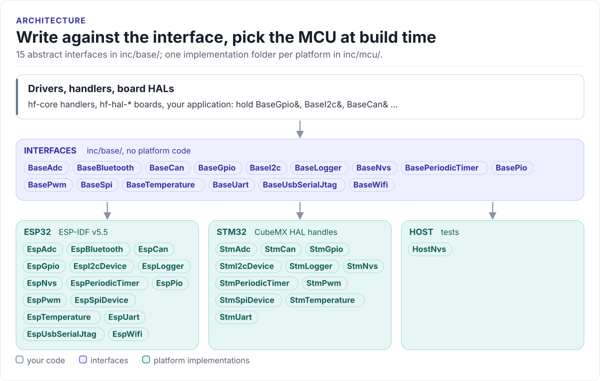
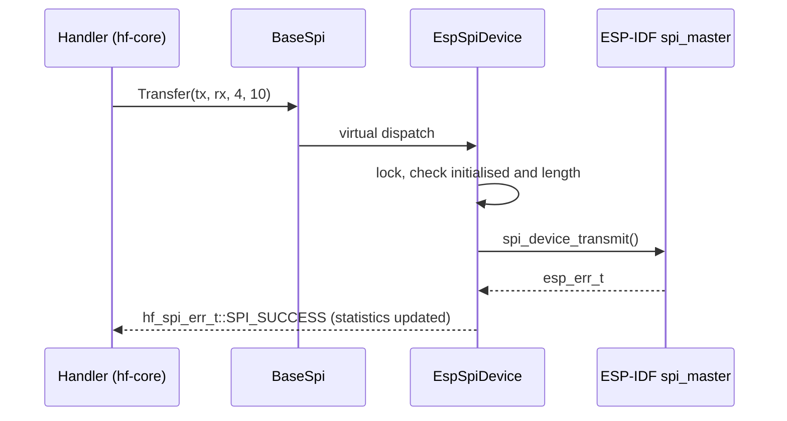

# Architecture

The model the library implements: abstract interfaces above, one implementation per platform below, and the
rules every interface follows.

<!-- figure: interface-layers -->
<picture>
  <source media="(prefers-color-scheme: dark)" srcset="diagrams/interface-layers.dark.svg">
  
</picture>
<!-- /figure -->

## Layers

| Layer | Files | Knows about |
| --- | --- | --- |
| Interfaces | [`inc/base/`](../inc/base/BaseGpio.h): `BaseGpio`, `BaseI2c`, `BaseCan`, ... and `HardwareTypes.h` | C++ standard headers only |
| ESP32 implementations | [`inc/mcu/esp32/`](../inc/mcu/esp32/EspGpio.h), [`src/mcu/esp32/`](../src/mcu/esp32/EspGpio.cpp) | ESP-IDF v5.5 drivers, FreeRTOS |
| STM32 implementations | [`inc/mcu/stm32/`](../inc/mcu/stm32/StmGpio.h), [`src/mcu/stm32/`](../src/mcu/stm32/StmGpio.cpp) | STM32Cube HAL handles |
| Host implementations | [`inc/mcu/host/`](../inc/mcu/host/HostNvs.h) | C++ standard library |
| Utilities | [`inc/utils/`](../inc/utils/McuSelect.h) | Interfaces and `PlatformMutex` |

Code above the interfaces (drivers, [hf-core](https://github.com/hardfoc/hf-core) handlers, board HALs) includes
only `inc/base/` headers and holds references such as `BaseSpi&`. The board's start-up code is the one place that
names a platform class.

## One call through the layers

## Lifecycle

Every interface follows the same three steps.

1. **Construct** with a configuration. The constructor stores it and touches no hardware, so objects can be
   globals or members created before the scheduler starts.
2. **Initialise** with `EnsureInitialized()` (idempotent) or `Initialize()`. Operations on an object that was
   never initialised return the interface's `*_ERR_NOT_INITIALIZED`.
3. **Use**, and optionally `Deinitialize()` / `EnsureDeinitialized()` to release the peripheral.

The interfaces are non-copyable. Platform objects that share a peripheral (several SPI or I2C devices on one bus)
are created by a bus object, `EspSpiBus` / `EspI2cBus`, which owns them and returns `BaseSpi*` / `BaseI2c*`.

## Errors

Each interface has its own `enum class` of error codes, defined once as an X-macro list
(`HF_CAN_ERR_LIST`, `HF_GPIO_ERR_LIST`, ...) that also generates a `constexpr` to-string function:

| Interface | Error type | To string |
| --- | --- | --- |
| `BaseGpio` | `hf_gpio_err_t` | `HfGpioErrToString()` |
| `BaseI2c` | `hf_i2c_err_t` | `HfI2CErrToString()` |
| `BaseSpi` | `hf_spi_err_t` | `HfSpiErrToString()` |
| `BaseCan` | `hf_can_err_t` | `HfCanErrToString()` |
| `BaseAdc` | `hf_adc_err_t` | `HfAdcErrToString()` |
| `BaseUart` | `hf_uart_err_t` | `HfUartErrToString()` |
| `BaseNvs` | `hf_nvs_err_t` | `HfNvsErrToString()` |

Code `0` is always success (`GPIO_SUCCESS`, `CAN_SUCCESS`, ...). Optional features that a platform does not
have return a "not supported" code (`CAN_ERR_UNSUPPORTED_OPERATION`, `GPIO_ERR_NOT_SUPPORTED`, ...)
from the base class default rather than failing to link. No interface throws; every method is `noexcept`.

## Statistics and diagnostics

Most interfaces keep counters in the base class (`hf_can_statistics_t`, `hf_gpio_statistics_t`, ...) and expose
them through `GetStatistics()` / `GetDiagnostics()`, reset with `ResetStatistics()` / `ResetDiagnostics()`. They
are for monitoring; control decisions use the return codes.

## Threads

Platform classes guard their state with `PlatformMutex` ([`inc/utils/PlatformMutex.h`](../inc/utils/PlatformMutex.h)).
The mutex delegates to a backend chosen at compile time:

| Build | Backend | Effect |
| --- | --- | --- |
| This repository alone, host tests | `NullMutexBackend` | Every lock compiles to nothing |
| Inside [hf-core](https://github.com/hardfoc/hf-core) | `PlatformMutexBackend.h` from hf-core, found with `__has_include` | Real RTOS mutexes |

So a standalone build gives no locking: share an object between tasks only when a backend is configured, or
serialise the calls yourself. Callbacks registered with CAN, GPIO interrupts and timers run in interrupt or timer
context; keep them short and hand work to a task (for CAN, through the RX ring; see [CAN](can.md)).

## MCU selection

[`inc/utils/McuSelect.h`](../inc/utils/McuSelect.h) turns one target macro into a family and capability macros.
Under ESP-IDF it is set from `CONFIG_IDF_TARGET_*`; elsewhere define exactly one `HF_TARGET_MCU_*` (CMake `-D`
wins over the file). Selecting none or two is a compile error. The list is in [Integration](integration.md#mcu-selection).

## Design choices

- **Virtual interfaces, not templates.** A board passes the same `BaseGpio&` to drivers in different libraries
  without templating them all on the platform. The cost is one indirect call per operation.
- **No exceptions, no RTTI.** The ESP-IDF component builds with `-fno-exceptions -fno-rtti`.
- **Buffers at set-up.** The CAN RX ring and TX queue are allocated in `EspCan::Initialize()`, never in the
  interrupt that fills them.
- **One header per interface.** A driver that needs only SPI includes only `BaseSpi.h` and `HardwareTypes.h`.

Next: [API guide](api-guide.md).
